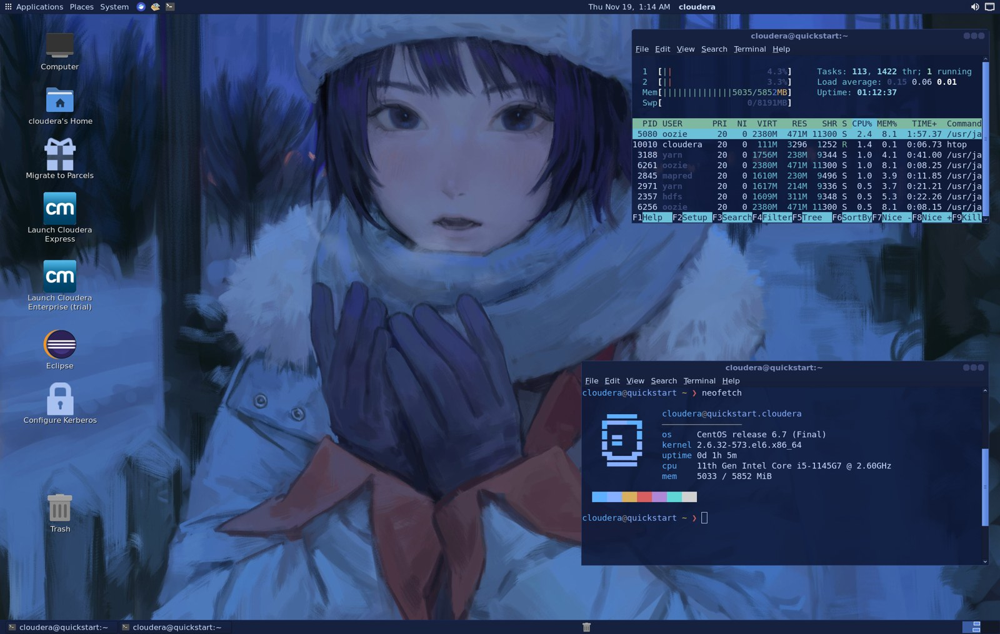

# cloudera-rice

One script that restyles the Cloudera QuickStart VM 5.12 (CentOS 6.7, GNOME 2) from the
host over SSH. It sets a wallpaper, a dark navy theme, Papirus-Dark icons, a matching
terminal and prompt, a tiny system-info tool, and a 125% UI scale.



## Usage

Start the VM, find its address with `ip a` inside it, then on the host:

```bash
./cloudera-rice.sh 192.168.159.161
./cloudera-rice.sh 192.168.159.161 --yum           # also fix yum and install htop
./cloudera-rice.sh 192.168.159.161 --no-icons      # skip the 33 MB icon copy
./cloudera-rice.sh 192.168.159.161 --wallpaper ~/Pictures/other.jpg
```

The script logs in as `cloudera` with password `cloudera` (override with `VM_USER` and
`VM_PASS`). It is safe to run again. After a run, reopen terminals and apps to see the new
theme everywhere.

Needs on the host: OpenSSH 8.4 or newer, `python3`, `curl`, `tar`. `python3-pil` is
optional and only used to recolour two desktop icons. The Papirus icons are copied from
`/usr/share/icons/Papirus` and `/usr/share/icons/Papirus-Dark` on the host, so install
`papirus-icon-theme` there first or pass `--no-icons`.

## What it changes on the VM

- **Wallpaper.** Downloaded to `~/Pictures/wallpaper.jpg` and set to zoom. Cloudera pins
  its own wallpaper in a mandatory gconf source, so the script also edits
  `/etc/gconf/gconf.xml.mandatory/desktop/gnome/background/%gconf.xml` (backup saved as
  `%gconf.xml.bak`). The default is wallhaven `gwdpz7`; `--wallpaper` takes a URL or a file.
- **GTK2 theme `DarkBlue`.** Navy backgrounds, light blue text, blue selection. The VM has
  no murrine engine, so modern dark themes such as Arc or Adwaita-dark cannot render. This
  theme is built on the built-in clearlooks engine instead.
- **Metacity theme `DarkBlue`.** Navy title bar with a centered title and three round
  buttons on the right (minimize, maximize, close) coloured from the wallpaper: window-light
  amber, snow blue, scarf red. Inactive windows get muted grey buttons.
- **Icons.** Papirus-Dark, copied into `~/.icons`.
- **Terminal and prompt.** Dark navy profile with a blue palette, slight transparency, and
  a coloured `user@host path ❯` prompt.
- **minifetch.** A 25-line replacement for neofetch (about 1 KB, against roughly 10,000
  lines for neofetch, which is not in the CentOS 6 repos). It runs when you open a terminal
  and is also available as `neofetch`. It only runs in interactive shells, because a banner
  printed over plain SSH would corrupt `scp` transfers.
- **125% scale.** GNOME 2 has no real scale setting, so this sets font DPI to 120, makes
  both panels 30 px tall, and sets the Nautilus icon zoom to large.
- **Desktop glyphs.** The black Kerberos lock and Parcels gift icons are recoloured light
  blue. The originals are kept next to them as `*.orig.png` in `~/Documents/img`.

## Fixing yum (`--yum`)

CentOS 6 is end of life, its mirror list is gone, and its old TLS library cannot connect to
any HTTPS mirror, so `yum` fails with "Cannot find a valid baseurl" or "problem making ssl
connection". With `--yum` the script starts a small HTTP proxy on the host that forwards
`vault.centos.org/6.10` and the EPEL 6 archive over HTTPS, points the VM's repos at it,
sets `skip_if_unavailable=1` on the dead Cloudera and VMware-tools repos, and installs
`htop`. Original repo files are saved in `/root/yum.repos.bak` on the VM.

The proxy runs only while the script runs. To install more packages later, run the script
with `--yum` again or start the proxy yourself. GPG checking is off for the proxied repos.

## Notes

- Memory: the VM runs the whole Hadoop stack (about 20 Java processes) and uses roughly
  5 GB of RAM. That is normal for the QuickStart VM, not caused by this script. The VMX
  was raised from 4 GB to 6 GB and 2 CPUs separately, by editing the `.vmx` file.
- The wallpaper and Papirus icons belong to their authors and are not stored in this repo.
